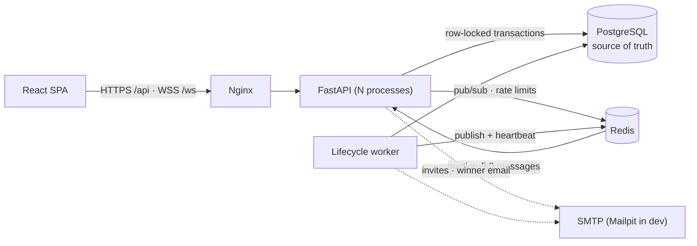

# British Auction RFQ System

A Request-for-Quotation platform where buyers run **British Auctions** for freight: suppliers
bid openly and keep lowering their prices, bids near the close **automatically extend** the
auction, and a **forced close** time guarantees it ends. Everyone watching sees the auction
update live.

**Stack:** React 19 + TypeScript + MUI · FastAPI (Python 3.13) · PostgreSQL 16 · Redis 7 · Nginx

---

## Contents

1. [Features](#features)
2. [Quick start](#quick-start)
3. [Demo walkthrough](#demo-walkthrough)
4. [Auction rules](#auction-rules)
5. [Architecture](#architecture)
6. [How the key parts work](#how-the-key-parts-work)
7. [API overview](#api-overview)
8. [Project structure](#project-structure)
9. [Configuration](#configuration)
10. [Production deployment](#production-deployment)
11. [Development](#development)
12. [Known limitations](#known-limitations)

---

## Features

**For buyers**
- Create an RFQ with bid start, bid close, **forced close** and pickup date; turn on British
  Auction rules: trigger window **X**, extension **Y**, and the trigger type
  (*any bid* / *any rank change* / *new lowest bidder*).
- Invite suppliers by email. Suppliers are **invite-only**: a new email receives a one-time
  sign-up link; an existing supplier is notified.
- Live auction page: every quote ranked **L1, L2, …** with its charge breakdown, the current and
  original close time, and an activity log that explains **why** each extension happened.
- Edit or cancel before bidding opens; remove an invite if that supplier hasn't bid.

**For suppliers**
- See only RFQs you were invited to. Submit a quote (carrier, freight / origin / destination
  charges, transit time, validity) and keep lowering it.
- See your rank and the current L1 price; competitors are shown anonymously as "Bidder N".
- Get notified instantly when the auction is extended or closes, and by email if you win.

**Platform**
- Real-time updates over WebSockets (Redis pub/sub across API processes).
- A background worker opens and closes auctions exactly on time and records the winner.
- Secure sessions (rotating refresh tokens), rate limiting, security headers, and a
  production setup behind Nginx.

---

## Quick start

Requires **Docker Desktop**.

```bash
cp .env.example .env     # optional: change host ports if 5432/6379/8080/5173 are taken
make up                  # builds and starts everything
make seed                # demo buyer, 4 suppliers and 3 demo auctions
```

| What | URL |
|---|---|
| App | http://localhost:5173 |
| Email inbox (Mailpit — catches every email the app sends) | http://localhost:8025 |
| API docs (Swagger) | http://localhost:8080/api/v1/docs |
| Health | http://localhost:8080/health/ready |

**Demo accounts** (password `Demo@12345`; the login page has one-click buttons for them):

| Role | Email |
|---|---|
| Buyer | `buyer@example.com` |
| Suppliers | `supplier1@example.com` … `supplier4@example.com` |

`make logs`, `make ps` and `make down` manage the stack. Migrations run automatically on start.

---

## Demo walkthrough

1. **Buyer** (`buyer@example.com`): **Create RFQ** → set bid start ~2 minutes ahead, bid close
   ~6 minutes after that, forced close later still; trigger window **10**, extension **5**,
   trigger *Any bid received*; invite `supplier1@example.com`, `supplier2@example.com` and
   `newcarrier@example.com`.
2. **Mailpit** (http://localhost:8025): the two existing suppliers got "New RFQ" notices;
   `newcarrier@example.com` got a sign-up link. Open it to create that supplier's account.
3. **Supplier** (in a second browser or private window): open the RFQ. When bidding opens, the
   quote form appears automatically.
4. **Bid inside the last 10 minutes**: the close time moves out by 5 minutes on *every* open
   page (no refresh), with a notice explaining the reason. Try bidding higher than your own
   current quote: it's rejected.
5. **Wait for the close**: the auction closes by itself; the buyer sees the winner, suppliers
   see their final rank, and the winner receives a "You won" email in Mailpit.

---

## Auction rules

How the engine interprets the specification, including the points it leaves open
(implemented in [`backend/app/domain/bidding.py`](backend/app/domain/bidding.py)):

| # | Rule |
|---|---|
| D1 | A quote's price is **freight + origin + destination** charges (computed by the database). |
| D2 | A supplier may bid repeatedly; each new bid must be **strictly lower** than their current one. Their latest bid is their active quote. |
| D3 | Equal totals: the **earlier** bid ranks higher. |
| D4 | Extension: `new close = min(current close + Y, forced close)` — never past the forced close. |
| D5 | The trigger window is `[current close − X, current close)` and **slides** with each extension. Bids are accepted from the start up to (not including) the current close. |
| D6 | "Any rank change" = a supplier who **already had a rank** moved. A newcomer entering at the bottom isn't a change. |
| D7 | "L1 change" needs a previous L1 — the very first bid doesn't count as a change. |
| D8 | **Force Closed** = the auction ended at the forced close (extensions hit the cap); **Closed** = it ended earlier. |
| D9 | "Now" is the **database clock**, read after taking the auction's row lock, so all servers agree. |
| D10 | The buyer sees everything. Suppliers see every price and rank, but competitors appear as "Bidder N" without their charge breakdown. |
| D11 | Schedule and auction rules can be edited only before bidding starts. |
| D12 | Suppliers are **invite-only**; public sign-up creates buyer accounts. |
| D13 | An invite can be removed until the auction ends, **unless that supplier has bid**. |
| D14 | A quote must stay valid **at least until the pickup date**, so the winning price can't lapse before the goods move. |

**Statuses:** Upcoming → Active → Closed / Force Closed (or Cancelled before it starts).

---

## Architecture



| Component | Responsibility |
|---|---|
| **React SPA** | Auction list and details, RFQ form, bid form, live updates, countdowns synced to server time. |
| **FastAPI** | REST API, WebSocket endpoint, all business rules. Stateless: run as many processes as needed. |
| **Lifecycle worker** | Opens auctions at their start, closes them at their (possibly extended) close, records the winner, emails them. |
| **PostgreSQL** | Every piece of durable data. Row locks serialise bids per auction. |
| **Redis** | Fan-out of live updates to every API process, rate limits, worker heartbeat. Holds nothing that can't be lost. |
| **Nginx** (production) | Serves the built SPA, proxies `/api`, `/health` and the `/ws` WebSocket, adds security headers. |

The backend is layered so the auction logic stays readable and framework-free:

```
api/ (HTTP + WebSocket)  →  services/ (use cases, transactions)  →  domain/ (pure rules)
                                       ↓
                              repositories/ (SQL)  →  models/ (tables)
```

---

## How the key parts work

### Placing a bid

Everything happens in **one database transaction** that holds the auction's row lock
([`bidding_service.py`](backend/app/services/bidding_service.py)):

1. Lock the RFQ row (`SELECT … FOR UPDATE`) and read the time **from the database**.
2. Check the supplier is invited, bidding is open, the quote is valid, and the new total is lower
   than their current one.
3. Load every supplier's current quote once → ranking **before**; insert the bid → ranking **after**.
4. Ask the rules ([`domain/bidding.py`](backend/app/domain/bidding.py)) whether this bid
   extends the auction, and by how much (capped at the forced close).
5. Update the close time and the L1 price, write the activity-log entries, commit.
6. After the commit, publish a live update.

Because the lock serialises bids **per auction**, two near-simultaneous bids can never both see
the same "before" ranking or double-extend; bids on different auctions run in parallel. Within
each API process, bids for the same auction queue *before* taking a database connection, so a
busy auction can't starve others. An `Idempotency-Key` header makes retries safe.

### Opening and closing auctions on time

The lifecycle worker ([`lifecycle_service.py`](backend/app/services/lifecycle_service.py))
runs every second:

- **Upcoming → Active** at bid start (log: *Bidding opened*).
- **Active → Closed / Force Closed** once the current close has passed; records the winning bid
  and counts, emails the winner, publishes the result.
- Uses `FOR UPDATE SKIP LOCKED`, so several workers can run safely and an auction being bid on at
  that instant is simply picked up on the next tick.
- Catches up after downtime.

Pages never depend on the worker's timing: the status shown is always derived from the clock,
and a bid re-checks the time under the lock, so a late bid is rejected even if the worker lags.

### Live updates

Each browser tab keeps one WebSocket (`/ws`):

```
bid or worker ── commit ──▶ Redis "auction:{id}" ──▶ every API process ──▶ subscribed browsers
```

- The access token is sent as the first message (never in the URL). When it expires the server
  closes with code `4401`; the client renews its session and reconnects.
- Subscriptions are access-checked exactly like opening the RFQ page.
- Messages carry only facts every viewer may see (status, close time, extension reason, current
  L1 price). Each page then reloads its own leaderboard and activity log, so competitor
  anonymity is enforced in one place.
- Every message has a sequence number; after a reconnect the client catches up on anything it
  missed. If WebSockets are unavailable, the UI falls back to polling and shows
  "Reconnecting…".

### Supplier onboarding (invite-only)

1. The buyer invites an email on an RFQ.
2. An **existing supplier** is attached immediately and notified.
   A **new email** gets a single-use sign-up link (valid 7 days; only a hash is stored; **Resend**
   replaces it).
3. The new account is created with the invited email and attached to **every** RFQ that email was
   invited to.

### Sign-in and sessions

- Short-lived **access token** (15 min, kept in memory by the browser) plus a **refresh token**
  in an `httpOnly`, `SameSite=Strict` cookie that only the auth endpoints receive.
- The refresh token is replaced on every use; reusing an old one while the session is active is
  treated as theft and ends that session. Only hashes are stored; passwords use Argon2id.
- The browser renews ~1 minute before expiry and coordinates renewals across tabs.

### Abuse protection

Redis rate limits (if Redis is down, requests are allowed rather than blocked):

| Endpoint | Limit |
|---|---|
| Login | 30/min per IP · 10 per 5 min per account |
| Register | 10/hour per IP |
| Invite links (inspect / accept) | 20/min per IP |
| Session refresh | 60/min per IP |
| Bids | 30/min per supplier per RFQ |
| Sending invitations | 200/hour per buyer |

Over the limit → `429 RATE_LIMITED` with a `Retry-After` header.

---

## API overview

All endpoints are under `/api/v1` (full interactive docs at `/api/v1/docs` in development).
Errors are `application/problem+json` with a stable `code` (e.g. `BID_NOT_LOWER`,
`AUCTION_CLOSED`) the UI switches on.

| Method | Path | Who | Purpose |
|---|---|---|---|
| POST | `/auth/register` | public | Create a buyer account |
| POST | `/auth/login` · `/auth/refresh` · `/auth/logout` | public | Sessions |
| POST | `/auth/invitations/inspect` · `/auth/invitations/accept` | public | Supplier sign-up from an invite link |
| GET | `/auth/me` | signed in | Current user |
| GET | `/rfqs` | signed in | Auction list (filter by status, search, paginate) |
| POST | `/rfqs` | buyer | Create an RFQ (+ invites) |
| GET | `/rfqs/{id}` | buyer / invited supplier | Details |
| PATCH | `/rfqs/{id}` | buyer | Edit before start (`If-Match: <version>`) |
| POST | `/rfqs/{id}/cancel` | buyer | Cancel before start |
| POST · DELETE | `/rfqs/{id}/invitations[/{email}]` | buyer | Invite / remove a supplier |
| POST | `/rfqs/{id}/invitations/{email}/resend` | buyer | Re-send an invite |
| POST | `/rfqs/{id}/bids` | invited supplier | Submit a bid |
| GET | `/rfqs/{id}/leaderboard` | buyer / invited supplier | Ranked quotes |
| GET | `/rfqs/{id}/bids` | buyer / invited supplier | Bid history (suppliers: own bids) |
| GET | `/rfqs/{id}/events` | buyer / invited supplier | Activity log |
| WS | `/ws` | signed in | Live updates |

---

## Project structure

```
backend/
  app/
    api/            HTTP routes (v1/), dependencies (auth, roles), health probes
    domain/         pure auction rules: ranking, extensions, statuses, schedule validation
    services/       use cases: RFQs, invitations, bidding, read models, lifecycle, auth
    repositories/   database queries
    models/         SQLAlchemy tables
    schemas/        request / response shapes
    realtime/       WebSocket endpoint, connection manager, Redis publisher
    email/          SMTP sender and email templates
    workers/        lifecycle worker process
    core/           settings, security, errors, logging, rate limiting, middleware
    cli/            demo data seeding
  alembic/          database migrations
frontend/
  src/
    app/            routing, providers, theme
    api/            fetch client (auth, errors, server-time sync)
    features/       auth, rfqs (list, form, details, bidding), realtime, system
    components/     shared UI (layout, form fields)
    lib/            dates, money, emails, shared clock
  nginx/            production web server config
docker-compose.yml        development stack
docker-compose.prod.yml   production-style stack
```

---

## Configuration

Settings come from environment variables (see [`backend/.env.example`](backend/.env.example)
and [`.env.prod.example`](.env.prod.example)). The important ones:

| Variable | Purpose |
|---|---|
| `DATABASE_URL`, `REDIS_URL` | Connections |
| `JWT_SECRET_KEY` | Token signing key (required, 32+ chars, outside local) |
| `REFRESH_COOKIE_SECURE` | `true` whenever served over HTTPS (required outside local) |
| `FRONTEND_BASE_URL` | Used to build links in emails |
| `EMAIL_BACKEND`, `SMTP_HOST`, `SMTP_PORT`, `EMAIL_FROM` | Outbound email |
| `ACCESS_TOKEN_TTL_MINUTES`, `REFRESH_TOKEN_TTL_DAYS` | Session lifetimes |
| `RATE_LIMIT_ENABLED`, `EXPOSE_API_DOCS` | Feature switches |

With `ENVIRONMENT=staging` or `production` the API refuses to start without a strong secret and
secure cookies.

---

## Production deployment

```bash
cp .env.prod.example .env.prod   # set JWT_SECRET_KEY and POSTGRES_PASSWORD
make prod-up                     # → http://localhost:8088   (Mailpit: http://localhost:8026)
make prod-down
```

- **One origin:** Nginx serves the built SPA and proxies `/api`, `/health` and `/ws`. Postgres
  and Redis are not exposed.
- **Images:** runtime-only and non-root; migrations run as a one-off job before the API starts;
  2 API processes (safe, because live updates go through Redis).
- **Hardening:** API docs hidden, HSTS, a strict Content-Security-Policy, long-lived caching for
  fingerprinted assets, gzip, a 1 MB request limit.
- **Email:** point `SMTP_*` at a real provider instead of the bundled Mailpit.
- **TLS:** terminate HTTPS at a load balancer or proxy in front of Nginx.
- Demo seed data is refused in production: register a buyer in the UI and invite suppliers.

---

## Development

| Command | What it does |
|---|---|
| `make up` / `make down` / `make logs` | Development stack with hot reload |
| `make seed` | Demo users and auctions |
| `make revision m="message"` | Generate a database migration |
| `make check` | Lint, type-check and build backend + frontend (what CI runs) |
| `make be-fmt` | Auto-format the backend |
| `make fe-lock` | Refresh `package-lock.json` after adding frontend packages |

**Without Docker** (Postgres and Redis still needed):

```bash
make setup
cp backend/.env.example backend/.env
cd backend && .venv/bin/alembic upgrade head && .venv/bin/uvicorn app.main:app --reload --port 8080
cd backend && .venv/bin/python -m app.workers.lifecycle     # second terminal
cd frontend && npm run dev                                   # third terminal
```

**Conventions:** timestamps are UTC (`timestamptz`); money is `NUMERIC` / `Decimal`, never
floats; every response carries an `X-Request-ID`; logs are structured JSON.

---

## Known limitations

- **Live updates and emails are sent just after the database commit.** If a process crashed at
  that exact instant, that one notification would be lost (the auction data is always correct,
  and pages catch up on their next refresh). A transactional outbox would guarantee delivery.
- **Only the winner is emailed** when an auction closes; other suppliers see their result in the app.
- **The winner is whoever is L1 at close**; there is no separate award/approval step.
- **No minimum bid decrement** (a supplier can undercut by ₹0.01).
- **One reference-number sequence** across all buyers (`RFQ-2026-000123`), suited to a single
  organisation.
